<div align="center">
  
</div>

<div align="center">

[](https://github.com/codeandearnyt/milkledger-releases/releases/latest)
[](https://github.com/codeandearnyt/milkledger-releases/releases)
[](#requirements)
[](#)

</div>

<br>

<h2 align="center">⬇️ Download</h2>

<table align="center">
  <tr>
    <td align="center" width="50%">
      <a href="https://github.com/codeandearnyt/milkledger-releases/releases/latest/download/MilkLedger.apk">
        
      </a>
      <br>
      <sub><b>User app</b> &nbsp;·&nbsp; 83.7 MB &nbsp;·&nbsp; for the dairy owner</sub>
    </td>
    <td align="center" width="50%">
      <a href="https://github.com/codeandearnyt/milkledger-releases/releases/latest/download/MilkLedger-Admin.apk">
        
      </a>
      <br>
      <sub><b>Admin app</b> &nbsp;·&nbsp; 56.6 MB &nbsp;·&nbsp; for the operator</sub>
    </td>
  </tr>
</table>

<div align="center">
<sub>The buttons above always point at the <b>newest</b> build — no version hunting.</sub>
</div>

<br>

## Which file do I need?

| You are… | Install | You get |
| :-- | :-- | :-- |
| **The dairy owner** | `MilkLedger.apk` | Daily entries, rates, ledger, reports |
| **The account operator** | `MilkLedger-Admin.apk` | Payments, users, plans, app config |
| Just exploring | User app | Everything works; admin is optional |

Both are **universal APKs** — one file covers 32-bit and 64-bit phones. No Google Play account needed.

<br>

## Install

1. **Tap a download button** above. The APK saves to your `Downloads` folder.
2. **Open the file** — from your notification shade, or *Files → Downloads*.
3. If Android shows **“For your security, your phone is not allowed to install unknown apps”**, tap **Settings → Allow from this source**, then go back.
4. If Play Protect says **“Unsafe app blocked”**, tap **More details → Install anyway**. The app is distributed here, not through the Play Store, so Play Protect has never scanned it.
5. **Open MilkLedger** and finish the 30-second setup: dairy name, phone, milk rate.

> Updating later? Install the new APK over the old one — your data stays.

<br>

## What's inside

<table>
<tr>
<td width="50%" valign="top">

**🥛 User app**

- Morning and evening entries in two taps
- Quick-pick litres, or any amount you type
- Rate per litre **or** per ½ litre
- Rate history — past dates keep their own rate
- Multiple sellers, one combined bill
- Month calendar and day ledger
- PDF report and WhatsApp summary
- Optional Plus plan removes ads

</td>
<td width="50%" valign="top">

**🛠️ Admin app**

- Overview: users, active Plus, pending, revenue
- Payment queue with proof viewer
- Approve or reject in one tap
- User detail: plan, expiry, device, ad control
- Activity log of every action
- App config, including the launch popup
- Subscription plans and pricing

</td>
</tr>
</table>

<br>

## Requirements

| | |
| :-- | :-- |
| **Android** | 6.0 Marshmallow (API 23) or newer |
| **Storage** | ~90 MB free for the user app, ~60 MB for admin |
| **Connection** | Needed for sign-in and sync; entries are kept on the phone |
| **Play Store** | Not required |

<br>

## FAQ

<details>
<summary><b>Is it free?</b></summary>
<br>
The app is free to use. The optional <b>Plus</b> plan removes ads and is billed monthly, quarterly, half-yearly or yearly.
</details>

<details>
<summary><b>How is a payment verified?</b></summary>
<br>
You pay by UPI, attach the payment proof in the app, and the operator verifies it manually — usually within <b>4 hours</b>, and never more than a day.
</details>

<details>
<summary><b>Why does Play Protect warn me?</b></summary>
<br>
Play Protect only recognises apps installed from the Play Store. Sideloaded APKs always show this warning. Choose <b>More details → Install anyway</b>.
</details>

<details>
<summary><b>Will I lose my data on update?</b></summary>
<br>
No. Installing a newer APK over the old one keeps all entries, sellers and settings.
</details>

<details>
<summary><b>The download opens as text or fails.</b></summary>
<br>
Use Chrome, or open the direct link from the latest release page. Some in-app browsers block APK downloads.
</details>

<br>

## Build details

| File | Version | Size | SHA-256 |
| :-- | :-- | --: | :-- |
| `MilkLedger.apk` | 1.0.0 | 83.7 MB | `9FDB0736…3DB8EF2` |
| `MilkLedger-Admin.apk` | 1.0.0 | 56.6 MB | `562C7F43…BDB9240` |

<details>
<summary>Full checksums</summary>

```text
MilkLedger.apk
9FDB0736FFE779CB4470E691E00C256D43060C54A5BE8D97D49BA6D413DB8EF2

MilkLedger-Admin.apk
562C7F43664E0A9EE358873A0635E52F833F061623E4039A1E622C56EBDB9240
```

</details>

Build date: **10 November 2026** · Built with Flutter and Firebase.

<br>

<div align="center">

[**All releases**](https://github.com/codeandearnyt/milkledger-releases/releases) &nbsp;·&nbsp; [**Changelog**](CHANGELOG.md) &nbsp;·&nbsp; [**Report a problem**](https://github.com/codeandearnyt/milkledger-releases/issues)

<sub>This repository hosts installable builds only — no source code.</sub>

</div>
