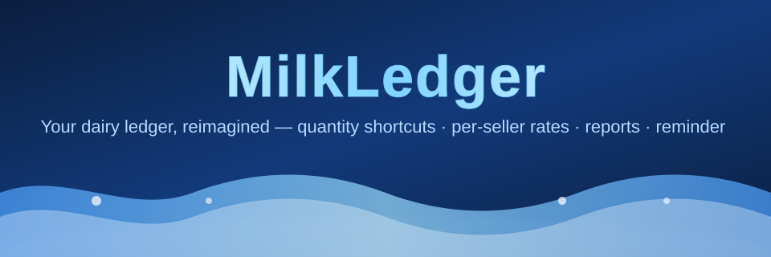
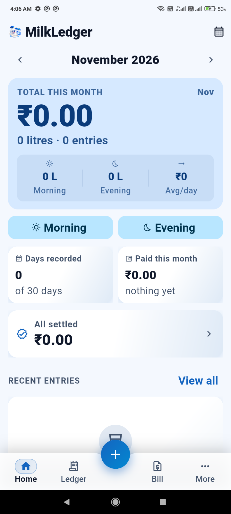
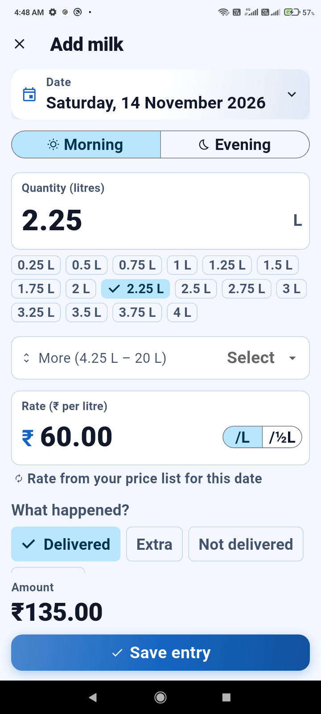
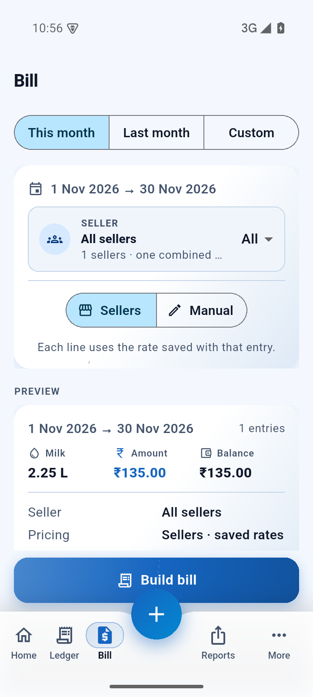
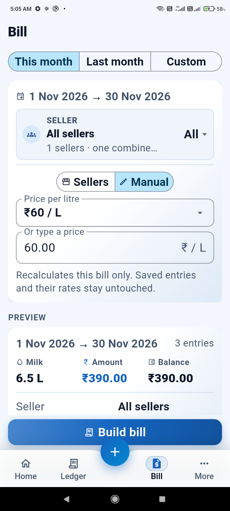
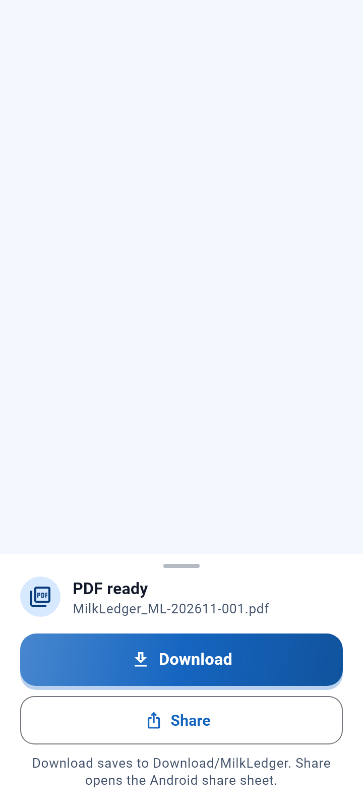
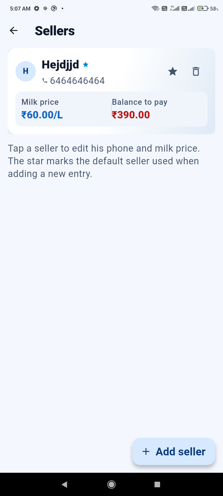

<div align="center">



# 🥛 MilkLedger

**A smart, offline-first dairy ledger for Android** — track milk deliveries from every seller, build bills at saved or manual rates, and download or share them as PDF.

[](https://github.com/codeandearnyt/milkledger-releases/releases/latest)
[](https://github.com/codeandearnyt/milkledger-releases/releases)


**Made by [Nitin Sharma](https://github.com/codeandearnyt) — © 2026 MilkLedger**

</div>

---

## ⬇️ Download

<div align="center">

<a href="https://github.com/codeandearnyt/milkledger-releases/releases/download/v1.1.2/MilkLedger-1.1.2.apk">
  
</a>

<sub><b>Universal</b> &nbsp;·&nbsp; 83.8 MB &nbsp;·&nbsp; one file, every phone</sub>

</div>

<br>

<div align="center"><sub>Want a smaller download? Pick your chip instead ↓</sub></div>

<br>

<table align="center">
  <tr>
    <td align="center" width="33%">
      <a href="https://github.com/codeandearnyt/milkledger-releases/releases/download/v1.1.2/MilkLedger-1.1.2-arm64-v8a.apk">
        
      </a>
      <br>
      <sub><b>39.8 MB</b> · 64-bit phones</sub>
    </td>
    <td align="center" width="33%">
      <a href="https://github.com/codeandearnyt/milkledger-releases/releases/download/v1.1.2/MilkLedger-1.1.2-armeabi-v7a.apk">
        
      </a>
      <br>
      <sub><b>38.3 MB</b> · 32-bit phones</sub>
    </td>
    <td align="center" width="33%">
      <a href="https://github.com/codeandearnyt/milkledger-releases/releases/download/v1.1.2/MilkLedger-1.1.2-x86_64.apk">
        
      </a>
      <br>
      <sub><b>41.4 MB</b> · emulators</sub>
    </td>
  </tr>
</table>

<div align="center">

<sub>Version <b>1.1.2</b> · <a href="https://github.com/codeandearnyt/milkledger-releases/releases">all releases</a> · <a href="https://github.com/codeandearnyt/milkledger-releases/releases/tag/v1.1.2">release notes</a></sub>

</div>

<br>

### Which one should I install?

| Your device | Install | Why |
| :-- | :-- | :-- |
| **Not sure** | **Universal** | Contains all chips — cannot be the wrong choice |
| Android phone from ~2017 or newer | `arm64-v8a` | Smaller file, most phones today |
| Older or budget 32-bit phone | `armeabi-v7a` | For phones that still report `armeabi-v7a` |
| Emulator / PC (BlueStacks, LDPlayer) | `x86_64` | Runs on Intel and AMD machines |

> Install the new APK over the old one — your entries, sellers and settings stay.

---

## ✨ Features

| Feature | Description |
|---|---|
| ⚡ **Quantity shortcuts** | Tap chips from `0.25 L` to `4.00 L`, or open the dropdown for `4.25 L` → `20 L`. |
| 👤 **Per-seller rates** | Every seller has their own milk price — per litre or per ½ litre. |
| 🧾 **Bill screen** | Build a bill at the saved seller rates or one manual price (₹50–₹200), with a live preview. |
| 📥 **PDF Download + Share** | Generate a bill PDF, then save it straight to `Download/MilkLedger/` or send it through the Android share sheet. |
| 📊 **Read-only Reports** | Issued bills and entry previews, plus a daily spend chart. Bills are frozen snapshots. |
| 🔁 **Repeat** | Repeat morning/evening entries in one tap. |
| ⏰ **Reminders** | Daily milk reminder + monthly bill reminder (scheduled on-device). |
| 🧩 **Home widget** | Shows this month's total, litres and entry count on your launcher. |
| 🔒 **App lock** | Fingerprint / face / phone-PIN protection. |
| ☁️ **Cloud backup** | Sign in, back up and restore your ledger via Firebase (free tier). |
| 🚫 **Manage Ads (Plus)** | Paid plan + admin-granted permission hides ads. |

**Design choices:** local-first storage (sqflite) — the ledger works fully offline; the cloud layer is optional and auto-detects when configured.

---

## 📸 Screenshots

| Home | Add milk | Bill · Sellers |
|---|---|---|
|  |  |  |

| Bill · Manual | PDF ready | Sellers |
|---|---|---|
|  |  |  |

---

## 🛠 Tech stack

- **Flutter / Dart** — UI, state, platform channels
- **Firebase Auth** — email/password sign-in
- **Cloud Firestore** — users, payments, admin meta (free tier)
- **sqlite3 / sqflite** — local ledger database
- **AdMob** — banner + interstitial ads (test IDs while in dev)
- **flutter_local_notifications** — reminders
- **home_widget** — launcher widget
- **PDF + share** — bill PDFs, Downloads save (MediaStore), and WhatsApp summaries

---

## 📱 Requirements

| | |
| :-- | :-- |
| **Android** | 10 (API 29) or newer |
| **Storage** | ~90 MB for the universal APK, ~45 MB for a split |
| **Connection** | Optional — entries are kept on the phone; needed only for sign-in and cloud backup |
| **Play Store** | Not required |

---

## Install

1. **Tap a download button** above. The APK saves to your `Downloads` folder.
2. **Open the file** — from your notification shade, or *Files → Downloads*.
3. If Android shows **“For your security, your phone is not allowed to install unknown apps”**, tap **Settings → Allow from this source**, then go back.
4. If Play Protect says **“Unsafe app blocked”**, tap **More details → Install anyway**. The app is distributed here, not through the Play Store, so Play Protect has never scanned it.
5. **Open MilkLedger** and finish the 30-second setup: dairy name, phone, milk rate.

> Updating later? Install the new APK over the old one — your data stays.

---

## 🆕 What's new in 1.1.1

- **Generate PDF** on a saved bill, then choose **Download** or **Share**.
- **Download** saves the PDF straight to `Download/MilkLedger/` — no dialog and no storage permission on Android 10+.
- **Share** opens the normal Android share sheet for WhatsApp, email or any other app.
- Includes everything from 1.1.0: the Bill tab, Sellers and Manual pricing, read-only Reports, and sliding screen transitions.

---

## FAQ

<details>
<summary><b>Is it free?</b></summary>
<br>
The app is free to use. The optional <b>Plus</b> plan removes ads and is billed monthly, quarterly, half-yearly or yearly.
</details>

<details>
<summary><b>How is a payment verified?</b></summary>
<br>
You pay by UPI, attach the payment proof in the app, and it is verified manually — usually within <b>4 hours</b>, and never more than a day.
</details>

<details>
<summary><b>Why does Play Protect warn me?</b></summary>
<br>
Play Protect only recognises apps installed from the Play Store. Sideloaded APKs always show this warning. Choose <b>More details → Install anyway</b>.
</details>

<details>
<summary><b>Which file do I need?</b></summary>
<br>
If you are unsure, take the <b>universal</b> APK. It contains every chip and installs on any supported Android phone.
</details>

<details>
<summary><b>Will I lose my data on update?</b></summary>
<br>
No. Installing a newer APK over the old one keeps all entries, sellers and settings.
</details>

<details>
<summary><b>The download opens as text or fails.</b></summary>
<br>
Use Chrome, or open the direct link from the latest release page. Some in-app browsers block APK downloads.
</details>

---

## Build details

| File | Size | SHA-256 |
| :-- | --: | :-- |
| `MilkLedger-1.1.1.apk` | 83.8 MB | `84B2C1FA…C15D` |
| `MilkLedger-1.1.1-arm64-v8a.apk` | 39.8 MB | `5A44DBEF…AFEA` |
| `MilkLedger-1.1.1-armeabi-v7a.apk` | 38.3 MB | `8F2A2EEF…C82E` |
| `MilkLedger-1.1.1-x86_64.apk` | 41.4 MB | `3FC8E7C8…75E3` |

<details>
<summary>Full checksums</summary>

```text
MilkLedger-1.1.1.apk
84B2C1FA8341336C5B0A4F97E725A806CED44D6E5C9D441AEF767A435F43C15D

MilkLedger-1.1.1-arm64-v8a.apk
5A44DBEF6560E32EDF0609C8F173AC2CE8A87439F9455EE30B8B81C3774FAFEA

MilkLedger-1.1.1-armeabi-v7a.apk
8F2A2EEFBE884192FA4DD7BD19A35F3F9D8010B6C637BFDE719C77E206D0C82E

MilkLedger-1.1.1-x86_64.apk
3FC8E7C81A48E91FB7238A33837E2E48A598E23A8F635299A3A533AB9A5A75E3
```

</details>

Build date: **13 November 2026** · Built with Flutter and Firebase.

<br>

<div align="center">

[**All releases**](https://github.com/codeandearnyt/milkledger-releases/releases) &nbsp;·&nbsp; [**Changelog**](CHANGELOG.md) &nbsp;·&nbsp; [**Report a problem**](https://github.com/codeandearnyt/milkledger-releases/issues)

<sub>This repository hosts installable builds only — no source code.</sub>

</div>
